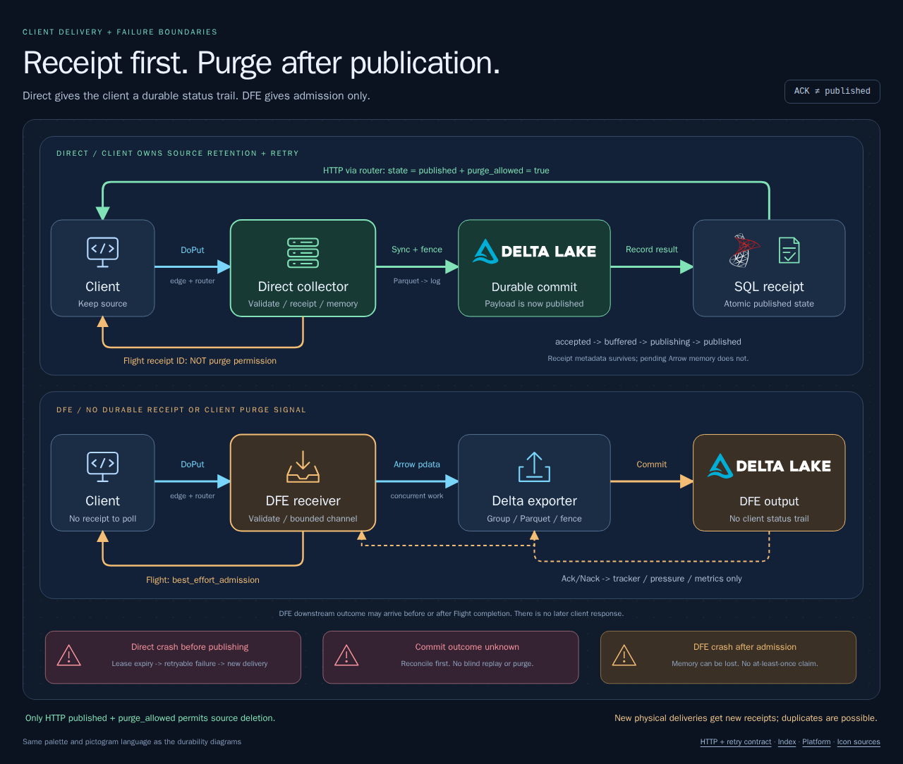

# Delivery guarantees and the client contract

[](diagrams/delivery.html)

[Architecture index](README.md)

**Direct has a client-managed at-least-once path. DFE currently does not.**
Retain the source until verified publication; tolerate duplicate rows.

| Contract | Direct | DFE |
| --- | --- | --- |
| Arbitrary Arrow / exact catalog admission | Yes | Yes, `arrowcol.flight@1.0` envelope |
| Flight completion | Receipt per non-empty RecordBatch | `best_effort_admission`, no receipt |
| SQL delivery receipt / HTTP polling | Yes | No |
| Source purge signal | HTTP `published` + `purge_allowed: true` only | None |
| At-least-once | Source retention + polling + retry/reconciliation | Not claimed |
| Downstream outcome | SQL receipt/publication state | Later internal Ack/Nack, pressure, metrics |
| Routing / commit fencing | Yes | Yes |
| Exactly-once / payload deduplication / native arbitrary-Arrow Quiver | No | No |

## Direct happy path

```text
Validate metadata, identity, lease, exact received schema
  -> SQL accepted receipt
  -> reserve bounded capacity; SQL buffered + Arrow arrays in memory
  -> Flight PutResult with receipt ID (NOT purge permission)
  -> grouped flush: SQL publishing
  -> close/sync Parquet; check fence; durable Delta log commit
  -> SQL atomically records publication and marks grouped receipts published
  -> client HTTP polls, verifies published + purge_allowed, then purges source
```

`delivery_guarantee: "durable_receipt"` describes durable **metadata**, not
durable pending payload storage. A completed Flight stream is not publication.
The client owns source retention and retry until publication is confirmed.

## Direct sad paths

| Observation | Client action |
| --- | --- |
| `accepted`, `buffered`, `publishing` | Retain source; keep polling with bounded backoff |
| `failed`, `status.error.retryable == true` | Retain source; resend as a new delivery, respecting `retry_after_ms` when present |
| `failed`, retryable false | Retain source; correct the input/configuration or escalate before retry |
| `publication_unknown` | Retain source; explicitly reconcile Delta/operator evidence; do not blindly replay |
| Poll timeout, SQL outage, missing receipt, malformed response | No purge; retry the read or investigate; HTTP failure alone does not justify resending |
| Flight fails after returning some receipt IDs | Track/poll those batches independently; retain unacknowledged batches |
| Flight response/receipt ID lost | Outcome is ambiguous; no lookup-by-payload key exists. Retain source; reconcile if possible; a recovery resend may duplicate |

An expired `accepted`/`buffered` receipt becomes retryable failure; after process
loss its Arrow arrays cannot be recovered from SQL. An expired `publishing` receipt becomes
`publication_unknown`: Delta may already contain the rows. Reconciliation must
resolve the existing receipt to `published` or `failed` before its retry policy
can be applied. There is no automatic payload replay from SQL.

Every physical resend creates a fresh server receipt, even for identical bytes.
An at-least-once client must persist source data and receipt-to-batch tracking
across its own restart, continue retries when useful, and handle unresolved
outcomes. Permanent rejection or abandoned reconciliation is not a delivery
guarantee. Downstream consumers must tolerate duplicates.

## HTTP polling through the router

Ingest is [Flight gRPC/HTTP2](routing.md#flight-metadata). Receipt polling is
HTTP JSON through the trusted edge/router, using valid edge authentication;
an unsigned curl is not a working authenticated example.
The router reads SQL itself, so polling does not depend on the original
collector being alive.

| Request | Successful response |
| --- | --- |
| `GET /v1/receipts/{uuid}` | HTTP 200: `{"status": {...}, "purge_allowed": false}` |
| `GET /v1/receipts?ids=<uuid>,<uuid>` | HTTP 200: `{"receipts": [...]}`; configured maximum, currently 256 in local router config |

Use the literal comma-separated `ids=` query shape; the router's parser is not
a general query decoder. Inspect every batch entry: `receipt_id`, `found`,
`purge_allowed`, optional `status`, optional structured `error`.
Missing/invalid stored entries can be returned inside a batch HTTP 200.

Example pending single-receipt response:

```json
{
  "status": {
    "protocol_version": 1,
    "receipt_id": "33333333-3333-4333-8333-333333333333",
    "table": {"catalog": "telemetry", "schema": "prod", "table": "traces"},
    "implementation_pool": "direct",
    "state": "accepted",
    "revision": 0,
    "updated_at_unix_ms": 1791737001000
  },
  "purge_allowed": false
}
```

`published` additionally requires `status.publication`: Delta version,
files/rows/bytes published, computed schema fingerprint, publication timestamp,
and table/owner/lease/fencing token. See the complete
[published wire fixture](../../../crates/arrowcol-protocol/tests/fixtures/receipt-published-v1.json).
Failed/unknown states instead carry `status.error` with protocol version, code,
category, retryable, message, and optional receipt ID/retry delay.

| HTTP outcome | Meaning / action |
| --- | --- |
| 200 | Read succeeded; only nested `published` plus `purge_allowed: true` permits purge |
| 400 | Invalid UUID/path/query or excessive batch; fix request |
| 401 / 403 | Missing/invalid proof or forbidden identity; fix authentication |
| 404 | Receipt/path not found; no purge |
| 405 | Receipt APIs require GET |
| 409 | Receipt-store conflict/fenced/draining error; no purge |
| 500 | Internal/corrupt-state error; investigate, no purge |
| 503 | SQL persistence unavailable; back off and retry polling, no purge |

Router errors use `{"error": {...}}` with structured `ErrorStatus`; do not infer
delivery success from HTTP status alone. Direct collector-admin single reads
add top-level `receipt_id` and `found`; their errors use
`{protocol_version, code, message}`. Prefer the router contract rather than
assuming these endpoint envelopes are identical.

## DFE: what actually happens

```text
Flight schema/identity/lease validation
  -> Arrowcol envelope + bounded pdata send
  -> stream completes: best_effort_admission (no receipt)
  -> independent exporter groups batches; writes Parquet; fenced Delta commit
  -> internal Ack on success / Nack on failure
  -> receiver resolves correlation tracker; updates pressure/metrics
```

Admission awaits channel backpressure; it does not wait for every downstream
Delta outcome. Exporter work is concurrent with Flight; Ack/Nack may arrive before
or after stream completion. Those signals
are internal accounting, not a second client response or a durable replay log.
A crash after admission can lose in-memory data without a queryable receipt.

DFE `/v1/capabilities` explicitly reports `delivery_guarantee: "best_effort"`,
`completion_mode: "best_effort_admission"`, `receipt_polling: false`,
`sql_delivery_receipts: false`, and `at_least_once: false`. There is no DFE
HTTP receipt/purge contract. Use direct delivery when the client needs the
implemented receipt-based at-least-once path.

Native Quiver for fixed OTAP slots does not persist this arbitrary-Arrow
representation; both pools reject unsupported persistence configuration.

Sources: [direct ingest](../../../projects/arrowcol-rust/src/ingest.rs),
[receipt reconciliation](../../../crates/arrowcol-receipts/src/sql_server.rs),
[router HTTP handlers](../../../projects/arrowcol-router-rust/src/router.rs),
[admin HTTP handlers](../../../projects/arrowcol-rust/src/admin.rs),
[PutResult wire contract](../../../crates/arrowcol-flight/src/put_result.rs),
[DFE receiver](../../../crates/arrowcol-dataflow-components/src/receiver.rs),
[DFE exporter](../../../crates/arrowcol-dataflow-components/src/exporter.rs).
