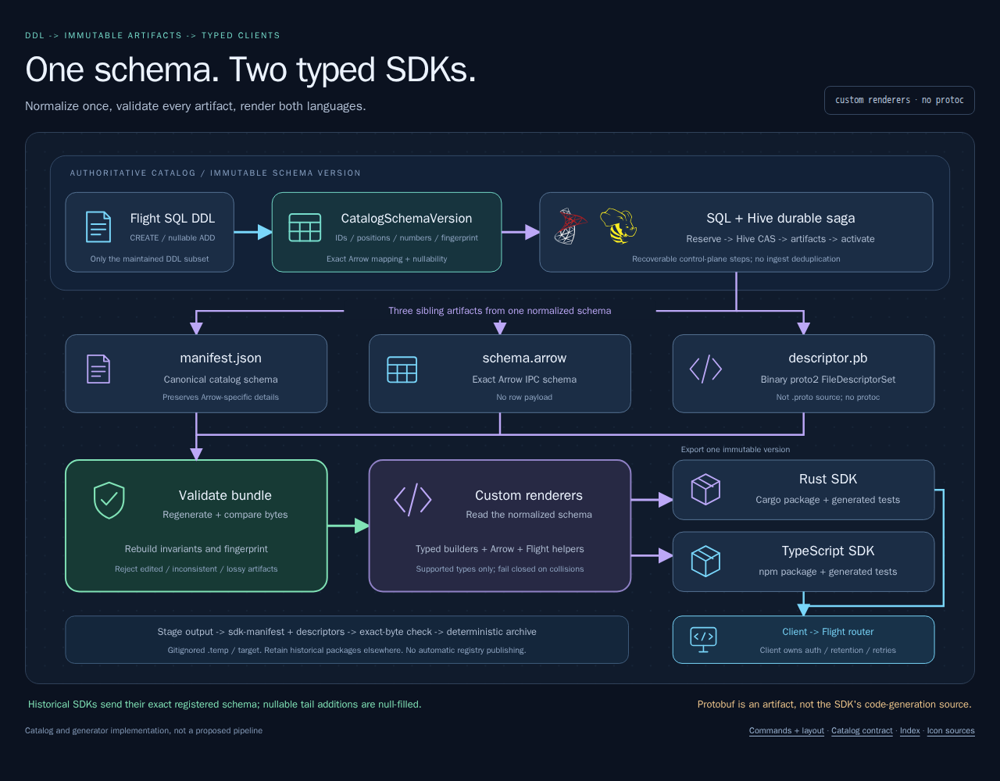

# DDL to client SDK

[](diagrams/sdk-generation.html)

[Architecture index](README.md)

**The flow is DDL -> normalized catalog -> validated artifacts -> custom
Rust/TypeScript renderers. It is not DDL -> protoc -> SDK.**

## One schema, three artifacts

```sql
CREATE TABLE telemetry.prod.events (
    id BIGINT NOT NULL,
    body VARCHAR NULL
)
```

The [DDL parser](../../../crates/arrowcol-catalog/src/ddl.rs) creates a
`CatalogSchemaVersion` with stable table/field identities, ordered positions,
protobuf field numbers, Arrow type/nullability/partition mappings, canonical
DDL, version, and fingerprint. The [SQL/Hive saga](catalog.md#durable-sqlhive-saga)
persists deterministic artifacts before activating the catalog head.

| Artifact | Purpose |
| --- | --- |
| `manifest.json` | Canonical normalized catalog schema; preserves Arrow-specific details |
| `schema.arrow` | Exact Arrow IPC schema message; no row data |
| `descriptor.pb` | Binary proto2 `FileDescriptorSet` generated with prost descriptor types |

These are sibling outputs of the normalized schema. The descriptor names a
versioned `.proto` file but does not emit that source file or invoke `protoc`.
Scalar non-null/nullable fields use required/optional labels; collection
representations use repeated/message mappings. The descriptor alone is not a
lossless replacement for the Arrow-aware manifest.

## Validate, render, package

```text
Export immutable version's artifacts
  -> rebuild manifest schema and fingerprint
  -> regenerate all 3 artifacts; require exact byte equality
  -> validate supported types and identifiers
  -> render Rust + TypeScript from the normalized schema
  -> stage/replace output; emit descriptors and hashed sdk-manifest
  -> check exact regeneration; optionally package deterministic archive
```

The generator rejects missing, edited, inconsistent, or lossy input.
`check` does not mutate output and rejects missing, extra, or changed files.
Write commands require workspace-relative output under gitignored `.temp` or
`target`; traversal, absolute paths, symlinked parents, and collisions fail closed.

| Generated API | Client responsibility |
| --- | --- |
| Typed row/nested builders; exact schema and RecordBatch construction | Supply values matching the generated types |
| Table/version/fingerprint constants; routing metadata; Flight request helpers | Configure authenticated transport and send requests |
| Receipt-ID parsing and receipt-status URL helpers | Persist source/receipt mapping, poll, retry/reconcile, enforce purge rule |

The packages are schema/building/protocol helpers, not an automatic networking
or retry service. Delivery differs by pool; see [client contract](delivery-guarantees.md).

## Local example

`fixture` is an example/test path, not production catalog registration:

```bash
cargo run --locked -p arrowcol-sdk-gen -- \
  fixture --ddl crates/arrowcol-sdk-gen/fixtures/telemetry-events.sql \
  --out crates/arrowcol-sdk-gen/.temp/catalog

cargo run --locked -p arrowcol-sdk-gen -- \
  generate --artifacts crates/arrowcol-sdk-gen/.temp/catalog \
  --out crates/arrowcol-sdk-gen/.temp/generated

cargo run --locked -p arrowcol-sdk-gen -- \
  check --artifacts crates/arrowcol-sdk-gen/.temp/catalog \
  --out crates/arrowcol-sdk-gen/.temp/generated

cargo run --locked -p arrowcol-sdk-gen -- \
  package-artifact --input crates/arrowcol-sdk-gen/.temp/generated \
  --out crates/arrowcol-sdk-gen/.temp/arrowcol-sdk.tar.gz
```

```text
crates/arrowcol-sdk-gen/.temp/
  catalog/{manifest.json,schema.arrow,descriptor.pb}
  generated/
    sdk-manifest.json
    descriptors/{manifest.json,schema.arrow,descriptor.pb}
    rust/{Cargo.toml,src/lib.rs,tests/generated.rs}
    typescript/{package.json,src/index.ts,test/generated.test.ts}
```

`sdk-manifest.json` records identity, version, fingerprint, descriptor hashes,
Flight routing details, package roots, and generated-file hashes.
Generation replaces staged output so old files disappear.

The [load generator integration](../../../projects/loadtest/loadgen/src/sdk.rs)
registers real DDL through Flight SQL, checks the SQL catalog head, exports the
version's artifacts via `CatalogStore::artifacts`, and runs `generate` + `check`
per table:

```text
projects/loadtest/.temp/loadgen/<run-id>/artifacts/<table>/
projects/loadtest/.temp/loadgen/<run-id>/generated/<table>/
```

It consumes generated manifests/descriptors for batch construction. There is
no automatic public HTTP artifact export or npm/crates registry publishing
implied by this workflow.

## Evolution and limits

```sql
ALTER TABLE telemetry.prod.events
ADD COLUMNS (source VARCHAR NULL)
```

The new immutable version preserves existing fields, positions, numbers, types,
nullability, and partition roles. A historical SDK can still send its **exact
registered** old layout; the collector reuses its arrays and null-fills only
new trailing fields.

`compatibility` checks catalog evolution plus protobuf wire/JSON stability:
removals, reordering, renumbering, name/type changes, required additions,
partition changes, or changed contents for one immutable version are rejected.

```bash
npx --no-install nx run arrowcol-sdk-gen:verify
```

Supported lossless mappings include scalars, timestamps/timezones, binary/view,
decimal, list/large-list/fixed-size-list, struct, and map. Dictionary and ListView
are rejected by the shared Rust/Arrow JavaScript construction path.

All generated roots are disposable and gitignored. Retain packaged historical
SDKs outside these roots if clients need them long-term.
See the [generator guide](../../../crates/arrowcol-sdk-gen/README.md) for
`compatibility` CLI arguments and individual Nx targets.

Sources: [artifact creation](../../../crates/arrowcol-catalog/src/artifacts.rs),
[artifact verification](../../../crates/arrowcol-sdk-gen/src/artifact.rs),
[renderers](../../../crates/arrowcol-sdk-gen/src/render/mod.rs),
[generation/check](../../../crates/arrowcol-sdk-gen/src/generate.rs),
[compatibility](../../../crates/arrowcol-sdk-gen/src/compatibility.rs).
