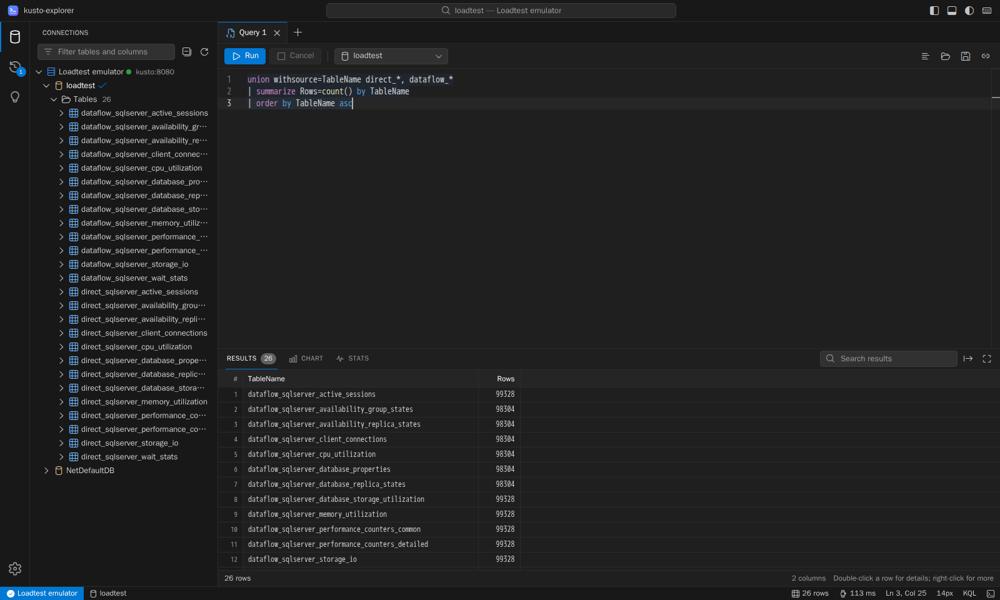
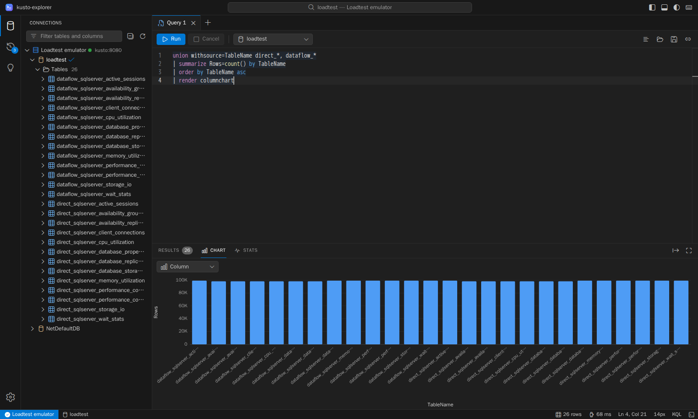
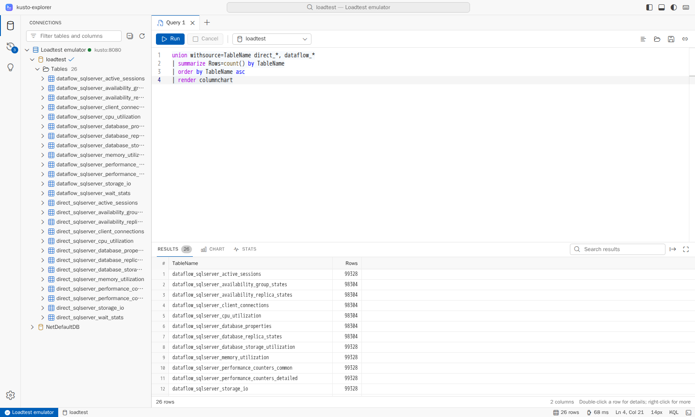

# kusto-explorer

A browser-based KQL workbench for Kusto clusters, written in Rust. A small Axum
server proxies queries to the clusters it is configured with, and a Leptos
WebAssembly app gives you a VS Code–style workspace: a schema tree, a multi-tab
KQL editor with IntelliSense, a virtualized results grid, and charts.



Every screenshot here is captured by the [loadtest](../loadtest/README.md) UI
gate. A real browser drives the UI on the live loadtest stack, against the local
Kusto emulator. The grid shows the row count of each of the 26 tables mirrored
from the loadtest's Delta output. The gate checks every count against Kusto's
own validation.

| `render columnchart` | Light theme |
| --- | --- |
|  |  |

## Features

### Query workflow

- **Connections tree.** Clusters, databases, tables, materialized views,
  functions, and external tables, down to typed columns. Filter it, refresh it,
  and use context menus to preview 100 rows, count rows, show a schema, extents,
  or a definition, or insert names into the query.
- **Multi-tab KQL editor.** Monaco with the Kusto language service: syntax
  highlighting, schema-aware completion, diagnostics, and formatting. Each tab
  keeps its own cluster, database, text, cursor, and results.
- **Run and cancel.** Run the selection or, without a selection, the query block
  at the cursor (blocks are separated by blank lines). Cancel a running query
  with **Shift+F5**. Management commands such as `.show tables` are sent to the
  management endpoint automatically.
- **Results.** Multiple result tables per query, in a virtualized grid with
  sorting, resizable columns, search, row details as JSON, and cell, row, and
  table copy. Cell menus insert `where` clauses for, or excluding, a value.
- **Charts.** `render` visualizations are drawn as SVG: time, line, area,
  stacked area, column, bar, pie, and scatter charts. You can also switch
  the chart type from the Chart tab.
- **Stats.** Execution and CPU time, peak memory, rows and extents scanned,
  result rows, and response size of every run.
- **History.** Every run, with its status, duration, and row count. Open or
  re-run any entry.
- **Export.** CSV, JSON, or Markdown downloads, or copy to the clipboard.
- **Files.** Open and save `.kql` files.

### Quality of life

- **Dark, light, or system themes.** Switch with the title-bar toggle or the
  command palette.
- **Command palette** (**Ctrl+Shift+P**) and **quick open** (**Ctrl+P**) for
  tabs, tables, and history.
- **Persistence.** Tabs, query text, history, theme, and layout survive reloads
  (browser local storage).
- **Shareable links.** Copy a link that opens the current query, cluster, and
  database in a new tab.
- **Starter queries** to explore an unfamiliar database.
- **Status bar.** Connection state, database, row count, duration, cursor
  position, and font size.
- **Resizable layout.** Resize or hide the side bar, maximize the results, or
  reset the layout.
- **Copy as KQL `datatable()`** to turn results into a self-contained query, or
  as a Markdown table for issues and docs.
- **Shortcut sheet** (**Shift+F1**) and font zoom (**Ctrl+=**, **Ctrl+-**,
  **Ctrl+0**).
- **Row cap.** Large results are truncated at the server, with a visible notice,
  instead of exhausting the browser.

### Keyboard shortcuts

| Action | Keys |
| --- | --- |
| Run the selection or the query at the cursor | **F5**, **Shift+Enter**, **Ctrl+Enter** |
| Cancel the running query | **Shift+F5** |
| Format the query | **Shift+Alt+F** |
| New or close tab | **Alt+N**, **Alt+W** |
| Next or previous tab | **Alt+PageDown**, **Alt+PageUp** |
| Open or save a `.kql` file | **Ctrl+O**, **Ctrl+S** |
| Command palette | **Ctrl+Shift+P** |
| Quick open | **Ctrl+P** |
| Toggle the side bar | **Ctrl+B** |
| Zoom in, out, or reset | **Ctrl+=**, **Ctrl+-**, **Ctrl+0** |
| All shortcuts | **Shift+F1** |

On macOS, **Cmd** replaces **Ctrl**.

## Run it

### With the loadtest

`npx --no-install nx run loadtest:run` starts kusto-explorer next to the Kusto
emulator. Open <http://localhost:8090> (override with `KUSTO_EXPLORER_PORT`).
The `Loadtest emulator` connection and the `loadtest` database are preselected.

Inside Compose, the kusto-explorer server reaches Kusto at `http://kusto:8080`,
the Compose service name on the stack's Docker network. Your browser talks only
to kusto-explorer, and kusto-explorer never goes through the host to reach
Kusto.

### Standalone container

Attach the container to the Docker network of your cluster and address the
cluster by its container or service name:

```bash
docker run --rm --network my-kusto-network \
  --publish 127.0.0.1:8090:8080 \
  --env 'KUSTO_EXPLORER_CONNECTIONS=Emulator=http://kusto:8080' \
  --env KUSTO_EXPLORER_DEFAULT_DATABASE=NetDefaultDB \
  ghcr.io/mdrakiburrahman/rust-playground/kusto-explorer:latest
```

Then open <http://localhost:8090>. CI publishes `latest` from `main`, plus
`branch-<branch>` and `sha-<commit>` tags (see
[container publishing](../../docs/containers/publishing.md)). To build the local
`:dev` image instead, run `npx --no-install nx run kusto-explorer:image`.

The image runs as an unprivileged user (uid 10001), works with a read-only root
file system, and has a health check on `/healthz`.

### Configuration

Every setting is an environment variable or the matching command-line flag
(for example `--default-database`).

| Variable | Default | Meaning |
| --- | --- | --- |
| `KUSTO_EXPLORER_CONNECTIONS` | `Kusto=http://kusto:8080` | Clusters the server may reach, as `Name=uri` pairs separated by `;` |
| `KUSTO_EXPLORER_DEFAULT_DATABASE` | none | Database selected for new tabs |
| `KUSTO_EXPLORER_BIND` | `0.0.0.0:8080` | Listen address |
| `KUSTO_EXPLORER_QUERY_TIMEOUT_SECONDS` | `240` | Upper bound for one upstream request (1–3600) |
| `KUSTO_EXPLORER_MAX_RESPONSE_MIB` | `256` | Largest upstream response accepted (1–4096) |
| `KUSTO_EXPLORER_DEFAULT_ROW_CAP` | `50000` | Rows per result table sent to the browser (at most 500,000) |
| `KUSTO_EXPLORER_STATIC_DIR` | `/usr/share/kusto-explorer/www` | Built browser UI |
| `KUSTO_EXPLORER_LOG_JSON` | `false` | Log JSON lines instead of text |

`--validate-and-exit` validates the configuration, prints it, and exits.

kusto-explorer sends unauthenticated requests. Use it with local emulators or
clusters that accept them; Microsoft Entra ID sign-in is not supported.

## How it works

```text
browser ──same-origin /api──▶ kusto-explorer (Axum) ──HTTP──▶ Kusto cluster
  │                               │                     /v2/rest/query
  ├─ Leptos UI (Rust → wasm32)    ├─ static UI files    /v1/rest/mgmt
  └─ Monaco + Kusto language      └─ /healthz, /readyz
     service (web workers)
```

| Path | Contents |
| --- | --- |
| `src/` | `kusto-explorer` server: configuration, Kusto REST client (v1 and v2 response parsing), API routes, static files |
| `api/` | `kusto-explorer-api`: request and response types shared by the server and the UI |
| `ui/` | `kusto-explorer-ui`: the Leptos client-side app, compiled to `wasm32-unknown-unknown` |
| `web/` | TypeScript editor bridge (Monaco, Kusto language service, workers), styles, and the esbuild bundle |
| `tests/` | Server integration tests against an in-process mock cluster |

The server API is small:

| Route | Purpose |
| --- | --- |
| `GET /api/config` | Configured connections and the default row cap |
| `GET /api/connections/{id}/databases` | Databases of a connection |
| `GET /api/connections/{id}/databases/{database}/schema` | Schema tree plus the raw schema for the language service |
| `POST /api/query` | Run a query or management command |
| `POST /api/cancel` | Best-effort cancellation of a running query |
| `GET /healthz` | Liveness, without contacting a cluster |
| `GET /readyz` | `200` when every connection answers, `503` otherwise |

Security properties:

- The browser addresses clusters only by configured connection ID. It can never
  supply a cluster URL, so the server cannot be used to reach other hosts.
- Responses carry a strict Content Security Policy (scripts and workers from the
  same origin only), `nosniff`, `no-referrer`, and frame denial.
- Upstream responses and result sizes are bounded by the timeout, response size,
  and row cap settings.

## Development

```bash
npx --no-install nx run kusto-explorer:verify        # format-check, lint, typecheck, test, doc
npx --no-install nx run kusto-explorer:bundle        # build the browser UI into dist/
npx --no-install nx run kusto-explorer:serve -- \
  --bind 127.0.0.1:8095 --connections 'Local=http://kusto:8080'
npx --no-install nx run kusto-explorer:image-smoke   # build and smoke-test the :dev image
```

`bundle` needs the `wasm32-unknown-unknown` target and the `wasm-bindgen` CLI
whose version matches `Cargo.lock`; the image build installs both itself.
Point `--connections` at a cluster that the server can reach.

The UI crate also compiles natively, so `cargo clippy` and `cargo test` cover
its state, query-block, chart, and formatting logic without a browser.

### UI quality gate

`npx --no-install nx run loadtest:e2e` builds the image, starts the loadtest
stack, and, after the run, starts a Playwright browser container on the same
Compose network. It opens `http://kusto-explorer:8080` and fails the run unless:

- `/api/config` reports exactly one connection, `http://kusto:8080`, and the
  cluster is ready;
- the connections tree lists all 26 loadtest tables;
- the per-table row counts, exported as JSON from the UI, match
  `kusto-validation.json`;
- `.show tables | count` agrees with the tree;
- `render columnchart` draws one bar per table; and
- the page logs no console errors.

Evidence lands in `onelake/benchmark/latest/results/`:
`kusto-explorer-validation.json`, `kusto-explorer-export.json`, and the
`kusto-explorer-*.png` screenshots used in this README.

## Third-party software

The bundle includes [Monaco Editor](https://github.com/microsoft/monaco-editor)
(MIT) with its Codicon icon font (Codicons, CC BY 4.0) and
[`@kusto/monaco-kusto`](https://github.com/Azure/monaco-kusto) with the Kusto
language service (MIT). The image ships their license texts in
`/usr/share/kusto-explorer/www/THIRD_PARTY_NOTICES.txt`.
