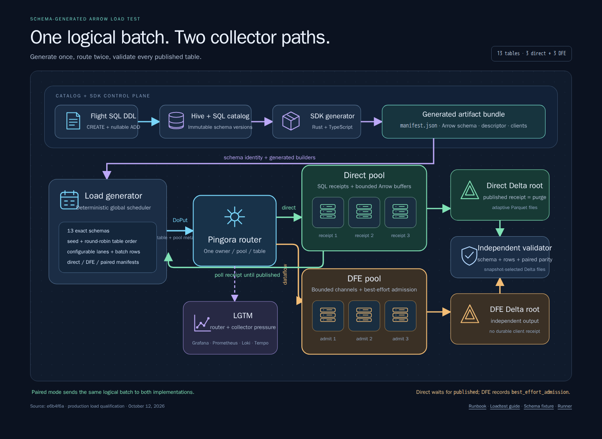

# loadtest

This project contains two deliberately separate local validation paths:

1. the existing three-signal OTEL demo/E2E; and
2. a production many-table Arrow Flight benchmark for the direct and DFE
   collectors behind the production router.

[](../../docs/architecture/loadtest/arrow-load-generator.html)

See the [load generator runbook](../../docs/architecture/loadtest/README.md) for
finite, continuous, focused-scenario, tuning, cleanup, and chaos commands.

## Production Arrow benchmark

The benchmark registers the exact ordered, non-nullable schemas in
[`schemas/sqlserver.sql`](schemas/sqlserver.sql) through the running Flight SQL
DataFusion DDL subset. It then exports the catalog's immutable
`manifest.json`, `schema.arrow`, and `descriptor.pb`, invokes
`arrowcol-sdk-gen generate` plus `check`, and constructs load exclusively from
the generated SDK manifest and Arrow schema descriptor. The client does not
maintain a second hand-written Arrow schema.

For run `<run-id>`, the host-side gitignored SDK workspace is:

```text
projects/loadtest/.temp/loadgen/<run-id>/artifacts/<table>/
projects/loadtest/.temp/loadgen/<run-id>/generated/<table>/
```

Each generated table directory contains `sdk-manifest.json`, `descriptors/`,
`rust/`, and `typescript/`. The run results retain the normalized public schema
contract in `onelake/benchmark/<run-id>/results/schema-contracts.json`; the
generated source packages remain disposable and are removed by
`loadtest:clean`.

The 13 public tables are:

```text
sqlserver_active_sessions
sqlserver_availability_group_states
sqlserver_availability_replica_states
sqlserver_client_connections
sqlserver_cpu_utilization
sqlserver_database_properties
sqlserver_database_replica_states
sqlserver_database_storage_utilization
sqlserver_memory_utilization
sqlserver_performance_counters_common
sqlserver_performance_counters_detailed
sqlserver_storage_io
sqlserver_wait_stats
```

Fields preserve their checked-in order, natural Arrow scalar type, UTC
nanosecond timestamps, and required status. Synthetic values are deterministic:
one seed-derived schema-valid row is repeated to the requested batch size,
matching SQL integer widths, stable UUID text, timestamp offsets, booleans,
floating-point counters, and string values. A single atomic scheduler rotates
by seed and then round-robins globally across all tables, so every finite phase
sends every table even when its requested duration is very short.

### Run commands

```bash
# Finite direct, dataflow, then paired scenarios.
npx --no-install nx run loadtest:benchmark -- \
  --run-id bench-1 --warmup 2m --measure 5m

# Live paired comparison; Ctrl+C stops load but retains the stack.
npx --no-install nx run loadtest:run -- \
  --run-id live --warmup 2m --continuous --keep-stack

# Stop a retained stack by using its Compose project name shown at startup.
npx --no-install tsx projects/loadtest/src/main.ts benchmark-down --run-id live
```

Supported benchmark flags are `--run-id`, `--warmup`, `--measure`,
`--capture-settle`, `--drain-timeout`, `--request-timeout`, `--continuous`,
`--keep-stack`, `--lanes`, `--batch-rows`, `--seed`, `--scenarios`, and
`--otel-baseline`. Durations accept integer seconds, `30s`, `2m`, or `1h`.
CLI values override `LOADTEST_*` environment values, which override built-in
defaults. Continuous mode always selects only `paired` and ignores the measure
duration. On Ctrl+C it drains direct receipts and retains the stack without
scanning the entire accumulated Delta history. The finite benchmark, chaos, and
`e2e` commands run the independent Delta validator; use those for bounded
acceptance.

Reusing a continuous run ID archives stale output beneath
`onelake/benchmark/archive/` when no matching Compose stack exists. If the
stack still exists, stop it with `benchmark-down` before restarting. Finite
benchmark IDs continue to fail rather than overwrite prior evidence.

Scenarios are explicit:

| Scenario | Delivery |
| --- | --- |
| `direct` | Arrow to the durable direct pool; every receipt is polled until `published`, a known failure, uncertainty, or the bounded drain timeout. |
| `dataflow` | Arrow to the DFE pool; the manifest records only honest `best_effort_admission`, never a receipt or at-least-once claim. |
| `paired` | One encoded logical batch is sent concurrently to both pools with the same logical ID, rows, schema, and payload digest. |
| `--otel-baseline` | Also starts the existing OTEL workload; its three-signal validation remains separate from arbitrary Arrow validation. |

Retries retain the logical batch ID but create a new physical attempt. Direct
collectors intentionally generate a distinct receipt for every byte-identical
delivery. Validation therefore requires at least one published copy for a
logical direct batch, not exactly one physical copy.

### Compose topology

The `benchmark` profile starts SQL Server, the official Hive Metastore, the
production router, three direct collectors, three DFE collectors, the load
driver, and the independent validator. Direct collectors share one host Delta
root and DFE collectors share another; the two pools never share a root.
Routing still assigns one fenced owner per pool/table. The validator requires
all 13 tables, all six collectors to own traffic, no cross-table routes, and
the DFE capability document to retain its durable-receipt gap.

```text
Flight SQL + generated SDK artifacts
                  |
             load driver
                  |
          production router
             /          \
  3 x direct pool      3 x DFE pool
         |                   |
 shared direct Delta   shared dataflow Delta
             \          /
       independent snapshots
              validator
```

If `compose.observability.yaml` exists, the CLI automatically layers it over
the base Compose file and starts its Prometheus, Grafana, Loki, Tempo, Alloy,
cAdvisor, SQL exporter, JSON exporter, and blackbox exporter services in the
same Compose project. The overlay retains `10.89.0.100` through
`10.89.0.108`; the base services use the lower addresses in the same
`10.89.0.0/24` network. `LOADTEST_RUN_ID` labels dashboards and scrapes.
Applications may export traces to `http://tempo:4318` (override
`LOADTEST_TRACES_ENDPOINT`). The base benchmark does not own the overlay's
configuration files.

Artifact-backed CI sets `CI_INTEGRATION=true`, so the finite E2E omits those
runtime observability containers to preserve memory for SQL/Hive and the six
collectors. CI validates the complete overlay separately. Set
`LOADTEST_OBSERVABILITY=true` to force the runtime stack in that environment,
or `false` to omit it from any benchmark run.

For retained runs, open Grafana at `http://127.0.0.1:3000` and Prometheus at
`http://127.0.0.1:9090`. Grafana keeps the arbitrary-Arrow comparison in the
**Arrow Flight** folder and the optional OTEL collector in the separate
**OTEL Collector Baseline** folder.

Each run is retained under `onelake/benchmark/<run-id>/`:

- `results/sent-batches.jsonl`: logical ID, table, schema, rows, Arrow bytes,
  payload digest, lane, pool, attempt, receipt, and acknowledgement outcome;
- `results/receipts.jsonl`: terminal direct receipt/publication evidence;
- `results/schema-contracts.json`: ordered schemas loaded from generated SDK
  artifacts;
- `results/routing.json`: collector registrations and pool/table lease owners;
- `results/capabilities.json`: direct versus DFE delivery claims;
- `results/validation.json`: independent Delta versions, active files, sizes,
  row counts/hashes, schema checks, parity, routing, and delivery results; and
- Compose logs/PS diagnostics.

The default finite run always removes its scoped Compose resources after
capturing diagnostics. `--keep-stack` is the only option that retains them.

### Production E2E

```bash
npx --no-install nx run loadtest:e2e
```

The target first runs the existing isolated OTEL three-signal acceptance, then
runs a finite Arrow benchmark with small batches and its chaos qualification.
The load driver first proves breaking-schema rejection before receipt,
byte-identical deliveries receiving distinct published receipts, bounded
in-flight backpressure, and honest DFE admission. The host harness then kills a
direct owner, waits for lease expiry, resends identical logical batches,
restarts it with a greater generation, pauses another owner through a lease
transfer to prove stale fencing, gracefully drains/restarts direct and DFE
collectors, and stops/restarts SQL Server to prove bounded failure and recovery.
Final routing evidence requires all six collectors across the 13 tables.

Run only that production qualification with:

```bash
npx --no-install nx run loadtest:chaos -- \
  --run-id chaos-1 --warmup 0 --measure 3s --batch-rows 64
```

Both E2E paths retain diagnostics and stop their stacks unless `--keep-stack`
is explicitly supplied. Focused Rust/TypeScript tests cover CLI precedence and
duration bounds, exact schema fixtures, deterministic generation, global
scheduling, manifests, Compose topology, snapshot validation, and bounded
request/receipt timeouts.

## Existing OTEL demo and validation

Two Docker Compose services: the locally built Rust collector and the existing
hello-world app emitting OTLP logs, metrics, and traces. No external backend or
cloud credentials are needed. Nothing is exposed on host ports.

```bash
npx --no-install nx run loadtest:up
npx --no-install nx run loadtest:logs
npx --no-install nx run loadtest:inspect
npx --no-install nx run loadtest:down
```

To remove retained local telemetry after stopping the workload:

```bash
npx --no-install nx run loadtest:clean
```

This deletes `onelake/`, including demo tables and E2E diagnostics, plus this
project's scratch, logs, and coverage. It preserves dependencies, Nx/Cargo
caches, build artifacts, and Docker images/volumes. It does not stop containers.

The demo greets once per interval until stopped. The root `onelake/demo/`
bind mount is gitignored and preserved when containers stop. Collector writes
use your non-root UID/GID, not privileged containers or checkout-wide chmod.
Re-running `up` rebuilds local source and recreates changed services.
The collector runs on two cores by default; set `LOADTEST_CORES` for the demo.
Each core streams Parquet independently and shares batched commits for each
Delta table.

## Architecture and what to observe

```text
[1] Local source                         [2] Nx + Docker Compose
    bin/hello-world/ -------------------> builds hello-world image
    crates/arrow-deltalake/ + adapter/ --> builds otelcol-rust image
    submodules/otel-arrow/ -------------> shared collector and hooks
    (including uncommitted fork edits)            |
                                                  v
    +-------------------- private Compose network -------------------+
    |                                                                |
    | [3] hello-world             OTLP HTTP/protobuf                 |
    |     greeting log     --+                                       |
    |     greetings counter +----> [4] otelcol-rust :4318            |
    |     greeting span    --+          OTLP receiver                |
    |                                  -> Delta exporter             |
    +------------------------------------------|---------------------+
                                               | flush + bind mount
                                               v
    [5] Local, gitignored onelake/
        demo/                     continuous run; retained after down
        e2e/e2e-<uuid>/            isolated finite test output
          logs/ + log_attrs/      greeting body + run.id
          univariate_metrics/     hello_world.greetings
          number_data_points/     counter values + joined attributes
          spans/ + span_attrs/    greeting spans + correlated IDs
                         |
                         v
    [6] loadtest:inspect / loadtest:e2e
        schemas, row counts, sample rows / content assertions + PASS
```

1. Edit the app or collector submodule. Local edits enter the build without first
   publishing a package; see
   [collector development](../otelcol-rust/README.md#editing-the-submodule).
2. `loadtest:up` builds both Dockerfiles and waits for collector readiness.
3. `loadtest:logs` shows repeated `Hello, World!` greetings and collector
   listener startup. The app exports a log, counter datapoint, and span.
4. The receiver accepts all three signals. Age-based Parquet flushes stage
   private files, then a per-table worker batches eligible files for up to
   10 seconds. Parent tables wait for child commits, so reader visibility can
   take several collection windows. Graceful shutdown forces pending waves.
5. Browse `onelake/demo/` for files, or a fresh `onelake/e2e/e2e-<uuid>/`
   after E2E. This is a **local folder**, not Microsoft Fabric OneLake.
6. `loadtest:inspect` shows schemas, counts, and two sample rows per table.
   `loadtest:e2e` must print `PASS` for marked logs, metric datapoints, and
   correlated traces; it does not treat file existence as successful delivery.

## E2E acceptance

```bash
npx --no-install nx run loadtest:e2e
```

The target builds both images and the Rust delta-rs inspection helper. It creates
a fresh Compose project and `onelake/e2e/e2e-<uuid>/` directory, waits for
collector readiness on two cores, and runs four independent finite emitters
with three greetings each. It reads snapshot-selected committed files and
requires a Delta commit containing files with different core namespaces.
Additional emitter rounds are bounded if the listener routes all connections
to one core. A separate marked run must still be unpublished before shutdown;
stopping the collector must deliver it. Restarting into the same tables must
deliver another run, preserve earlier rows, and advance table versions.

Acceptance requires three marked logs and spans **per emitter**, valid correlated
trace/span IDs, the expected greeting log body, and a marked counter datapoint
joined to `hello_world.greetings` that reaches three. Old files cannot satisfy a
new run. A failed app, missing signal, invalid/corrupt file, unsuccessful
collector shutdown, or timeout fails the target. Scoped Compose resources are
always removed; output and `compose.log` remain for inspection.

On successful runs, `inspection.json` contains the full finite dataset.
To inspect a specific run:

```bash
ONELAKE_INSPECT_PATH=onelake/e2e/e2e-<uuid> \
  npx --no-install nx run loadtest:inspect
```

Inspection prints schemas, row counts, and two sample rows per table.
Continuous demo data accumulates; stop the demo before inspecting a stable
snapshot. Delete only specific unwanted run directories when finished.

## Delta table layout

The experimental exporter writes OTAP payload tables, not three flattened
JSON-like tables:

| Signal  | Main tables                                | Associated attributes |
| ------- | ------------------------------------------ | --------------------- |
| Logs    | `logs`                                     | `log_attrs`           |
| Metrics | `univariate_metrics`, `number_data_points` | `number_dp_attrs`     |
| Traces  | `spans`                                    | `span_attrs`          |

Metric datapoints reference metric IDs; attribute rows reference their record's
ID with `parent_id`. All joins must also match `_otel_join_namespace`;
numeric IDs alone are not unique across restarts. `resource_attrs` and
`scope_attrs` provide additional
metadata. Trace/span IDs correlate the greeting logs with their spans.

Every populated payload directory has its own `_delta_log` and Parquet
data files. The Rust helper uses delta-rs to select active files and the Parquet
reader to inspect their contents; it never recursively scans orphan files.
Schemas, committed versions, active-file counts, file namespaces, and rows are
reported.
Large integers are serialized as strings to avoid JavaScript precision loss.
No Python/DuckDB installation or downloaded inspection image is needed.
For custom Docker-outside-Docker setups, set `LOADTEST_HOST_WORKSPACE` to the
daemon-visible checkout path. Standard devcontainers use their own mount
metadata automatically.
